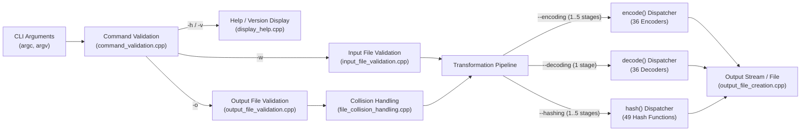

# Codeword


-brightgreen?style=flat-square)


**Codeword** is a fast, self-contained C++17 command-line wordlist transformation engine designed for security researchers, penetration testers, CTF competitors, and developers. It provides **36 encoding schemes**, **36 decoding schemes**, and **49 cryptographic, password, database, and checksum hashing algorithms**—all implemented from scratch in standard C++17 with **zero external library dependencies**.

---

## Table of Contents

- [Key Features](#key-features)
- [Architecture & Workflow](#architecture--workflow)
- [Getting Started](#getting-started)
  - [Prerequisites](#prerequisites)
  - [Building from Source](#building-from-source)
- [Command-Line Interface](#command-line-interface)
  - [Synopsis](#synopsis)
  - [Utility & Operation Flags](#utility--operation-flags)
  - [Execution Rules & Validation](#execution-rules--validation)
  - [Output Collision Handling](#output-collision-handling)
- [Supported Algorithms](#supported-algorithms)
  - [Encoding & Decoding Flags (36)](#encoding--decoding-flags-36)
  - [Hashing Flags (49)](#hashing-flags-49)
- [Usage Examples](#usage-examples)
- [Project Structure](#project-structure)

---

## Key Features

- **121 Built-In Transformations**:
  - **36 Encoders** & **36 Decoders** spanning RFC 4648 base encodings, Base58, Base62, Ascii85, UUEncode, Punycode, Quoted-Printable, HTML5 named/decimal/hex entities, URL & Double-URL, IIS `%uXXXX`, UTF-8/16/32 wire formats, ROT13/ROT47, and XOR obfuscation.
  - **49 Hash Functions** spanning MD2/4/5, SHA-1, SHA-2, SHA-3, Keccak, SHAKE128/256, BLAKE2b/2s, BLAKE3, RIPEMD-128/160/256/320, Tiger-192, Whirlpool, SM3, bcrypt (`$2b$`), MD5/SHA256/SHA512-crypt, PBKDF2, scrypt, LM, NTLM, MSSQL, MySQL, PostgreSQL, CRC-32/64, Adler-32, FNV-1a, and xxHash32/64.
- **Multi-Stage Chaining Pipelines**:
  - Chain up to **5 sequential encoding flags** or **5 sequential hashing flags** in a single pass (e.g., `plaintext -> UTF-8 -> Base64 -> URL-Encode`).
- **Zero External Dependencies**:
  - Compiles cleanly with any standard C++17 compiler (`g++`, `clang++`, `MSVC`) without requiring OpenSSL, Boost, or platform-specific crypto APIs.
- **Defensive File & CLI Validation**:
  - Validates argument order, flag compatibility, file existence, `.txt` extension constraints, non-empty input files, and parent directory paths before processing.
- **Interactive File Collision Resolution**:
  - Protects existing output files by prompting to **Overwrite**, **Append**, **Rename** (with re-validation), or **Exit**.

---

## Architecture & Workflow



---

## Getting Started

### Prerequisites

- A **C++17** compliant compiler:
  - **GCC** (`g++` 8 or newer)
  - **Clang** (`clang++` 7 or newer)
  - **MSVC** (Visual Studio 2017 15.7 or newer)

### Building from Source

#### Linux / macOS (Bash)

```bash
g++ -std=c++17 -O2 -Wall -Wextra -Wpedantic \
    -Iinclude -Iinclude/encoding -Iinclude/decoding -Iinclude/hashing \
    src/main.cpp \
    src/display_help.cpp \
    "src/command validation/command_validation.cpp" \
    "src/file validation/input_file_validation.cpp" \
    "src/file validation/output_file_validation.cpp" \
    "src/file handling/file_collision_handling.cpp" \
    "src/file handling/output_file_creation.cpp" \
    "src/function execution/encoding_functions.cpp" \
    "src/function execution/decoding_functions.cpp" \
    "src/function execution/hashing_functions.cpp" \
    src/encoding/*.cpp \
    src/decoding/*.cpp \
    src/hashing/*.cpp \
    -o codeword
```

#### Windows (PowerShell / MSYS2 MinGW-w64)

```powershell
$srcs = @(
    "src/main.cpp",
    "src/display_help.cpp",
    "src/command validation/command_validation.cpp",
    "src/file validation/input_file_validation.cpp",
    "src/file validation/output_file_validation.cpp",
    "src/file handling/file_collision_handling.cpp",
    "src/file handling/output_file_creation.cpp",
    "src/function execution/encoding_functions.cpp",
    "src/function execution/decoding_functions.cpp",
    "src/function execution/hashing_functions.cpp"
) + (Get-ChildItem "src/encoding/*.cpp", "src/decoding/*.cpp", "src/hashing/*.cpp").FullName

g++ -std=c++17 -O2 -Wall -Wextra -Wpedantic `
    -Iinclude -Iinclude/encoding -Iinclude/decoding -Iinclude/hashing `
    $srcs -o codeword.exe
```

---

## Command-Line Interface

### Synopsis

```text
codeword -w <wordlist.txt> --encoding <flag1> [flag2 ... flag5] [-o <output.txt>]
codeword -w <wordlist.txt> --decoding <flag>                    [-o <output.txt>]
codeword -w <wordlist.txt> --hashing  <flag1> [flag2 ... flag5] [-o <output.txt>]
codeword -h | --help
codeword -v | --version
```

### Utility & Operation Flags

| Flag | Long Form | Required | Description |
| :--- | :--- | :---: | :--- |
| `-h` | `--help` | Standalone | Display the full CLI help manual and exit. Cannot be combined with other flags. |
| `-v` | `--version` | Standalone | Display version and build metadata and exit. Cannot be combined with other flags. |
| `-w <path>` | `--wordlist <path>` | **Yes** | Path to the input wordlist (`.txt` file). Must exist, be a regular file, and be non-empty. |
| `-o <path>` | `--output <path>` | Optional | Path to the output file (`.txt` file). Parent directory must exist. |
| — | `--encoding` | **1 Mode** | Activate encoding mode. Follow immediately with **1 to 5** encoding sub-flags. |
| — | `--decoding` | **1 Mode** | Activate decoding mode. Follow immediately with **1** decoding sub-flag. |
| — | `--hashing` | **1 Mode** | Activate hashing mode. Follow immediately with **1 to 5** hashing sub-flags. |

### Execution Rules & Validation

1. **Mandatory Wordlist**: Every transformation run requires `-w <path>` (or `--wordlist <path>`) pointing to a valid, non-empty `.txt` file.
2. **Single Operation Mode**: Exactly one of `--encoding`, `--decoding`, or `--hashing` must be provided.
3. **Contiguous Sub-Flags**: Algorithm sub-flags (e.g., `-base64`, `-sha256`) must appear **immediately** after their operation flag (`--encoding`, `--decoding`, or `--hashing`).
4. **Pipeline Limits**:
   - `--encoding`: minimum `1`, maximum `5` chained flags.
   - `--decoding`: minimum `1`, maximum `1` flag.
   - `--hashing`: minimum `1`, maximum `5` chained flags.

### Output File & Collision Handling

- **Automatic Output (`-o` omitted)**:
  - Creates a `Wordcoder/` directory in the current working directory if it does not already exist.
  - Generates an output filename prefixed with the active operation sub-flags: `Wordcoder/<flag1>_..._<input_filename>`.
  - If a file with that name already exists, automatically suffixes `(1)`, `(2)`, etc. before the file extension via `File_Collision_Handling`.
- **Custom Output (`-o <path>` specified)**:
  - If the target file does not exist, prompts whether to create the file (and any missing parent directories) (`y/n`).
  - If the target file exists and is non-empty, prompts whether to append to it (`y/n`) or create a new auto-named file inside `Wordcoder/` (`y/n`).

---

## Supported Algorithms

### Encoding & Decoding Flags (`36`)

All 36 flags below are supported under both `--encoding` (via `encode()`) and `--decoding` (via `decode()`):

| Category | Flag | Specification / Format | Example (`"abc"` Encoded) |
| :--- | :--- | :--- | :--- |
| **Base / Radix** | `-base32` | RFC 4648 Base32 (`A-Z`, `2-7`, `=`) | `MFRGG===` |
| **Base / Radix** | `-base32hex` | RFC 4648 Extended Hex Base32 (`0-9`, `A-V`, `=`) | `C5H66===` |
| **Base / Radix** | `-base58` | Bitcoin Base58 alphabet | `ZiCa` |
| **Base / Radix** | `-base62` | Alphanumeric Base62 (`0-9`, `A-Z`, `a-z`) | `QmIN` |
| **Base / Radix** | `-base64` | RFC 4648 Base64 (`A-Z`, `a-z`, `0-9`, `+`, `/`, `=`) | `YWJj` |
| **Base / Radix** | `-base64url` | RFC 4648 URL-safe Base64 (`-`, `_`, unpadded) | `YWJj` |
| **Base / Radix** | `-base85` | Ascii85 / Base85 (`!` to `u`, `z` all-zero shortcut) | `@:E_W` |
| **Base / Radix** | `-uuencode` | POSIX UUEncode line format | `#86)C` |
| **Numeric / Byte** | `-ascii` | Space-separated unsigned byte values | `97 98 99` |
| **Numeric / Byte** | `-binary` | Space-separated 8-bit binary octets | `01100001 01100010 01100011` |
| **Numeric / Byte** | `-decimal` | Space-separated decimal byte values | `97 98 99` |
| **Numeric / Byte** | `-hex` | Lowercase hexadecimal byte string | `616263` |
| **Numeric / Byte** | `-octal` | Space-separated 3-digit octal byte values | `141 142 143` |
| **Web & Markup** | `-url` | RFC 3986 Percent-Encoding (unreserved preserved) | `abc` (`a%20b` for `"a b"`) |
| **Web & Markup** | `-url_all` | Full Percent-Encoding of all bytes | `%61%62%63` |
| **Web & Markup** | `-double_url` | Double Percent-Encoding (`%25XX`) | `%2561%2562%2563` |
| **Web & Markup** | `-html_entity_dec` | Decimal HTML entities (`&#NNN;`) | `&#97;&#98;&#99;` |
| **Web & Markup** | `-html_entity_hex` | Hexadecimal HTML entities (`&#xXX;`) | `&#x61;&#x62;&#x63;` |
| **Web & Markup** | `-html_entity_named` | HTML5 named character references (`&amp;`, `&lt;`, etc.) | `&amp;` (for `"&"`) |
| **Web & Markup** | `-quoted_printable` | RFC 2045 MIME Quoted-Printable (`=XX`) | `abc` |
| **Web & Markup** | `-punycode` | RFC 3492 IDN Punycode bootstring | `abc-` |
| **Escapes** | `-hex_escape` | C/JS hexadecimal byte escapes (`\xXX`) | `\x61\x62\x63` |
| **Escapes** | `-octal_escape` | C/POSIX 3-digit octal escapes (`\OOO`) | `\141\142\143` |
| **Escapes** | `-unicode_escape` | Unicode escapes (`\uXXXX` / `\UXXXXXXXX`) | `\u0061\u0062\u0063` |
| **Escapes** | `-unicode_codepoint` | Unicode code point notation (`U+XXXX`) | `U+0061 U+0062 U+0063` |
| **Escapes** | `-unicode_iis` | Microsoft IIS Unicode percent-u (`%uXXXX`) | `%u0061%u0062%u0063` |
| **UTF Wire Hex** | `-utf8` | UTF-8 encoded bytes in hex | `616263` |
| **UTF Wire Hex** | `-utf16` | UTF-16LE with `FF FE` BOM in hex | `fffe610062006300` |
| **UTF Wire Hex** | `-utf16be` | UTF-16 Big-Endian (no BOM) in hex | `006100620063` |
| **UTF Wire Hex** | `-utf16le` | UTF-16 Little-Endian (no BOM) in hex | `610062006300` |
| **UTF Wire Hex** | `-utf32` | UTF-32LE with `FF FE 00 00` BOM in hex | `fffe0000610000006200000063000000` |
| **UTF Wire Hex** | `-utf32be` | UTF-32 Big-Endian (no BOM) in hex | `000000610000006200000063` |
| **UTF Wire Hex** | `-utf32le` | UTF-32 Little-Endian (no BOM) in hex | `610000006200000063000000` |
| **Ciphers / XOR** | `-rot13` | ROT13 Caesar cipher (`A-Z`, `a-z` shifted by 13) | `nop` |
| **Ciphers / XOR** | `-rot47` | ROT47 ASCII cipher (`0x21-0x7E` shifted by 47) | `234` |
| **Ciphers / XOR** | `-xor` | Single-byte XOR with default key `0x5A` (hex output) | `3b3839` |

---

### Hashing Flags (`49`)

All 49 flags below are supported under `--hashing` (via `hash()`):

| Family | Flag | Algorithm / Standard | Output Format / Size | Notes & Default Parameters |
| :--- | :--- | :--- | :--- | :--- |
| **Checksums** | `-adler32` | RFC 1950 Adler-32 | 8 hex chars (32-bit) | Big-endian hex representation |
| **Checksums** | `-crc32` | IEEE 802.3 CRC-32 | 8 hex chars (32-bit) | Polynomial `0xEDB88320` |
| **Checksums** | `-crc64` | ECMA-182 / XZ CRC-64 | 16 hex chars (64-bit) | Reflected polynomial `0xC96C5795D7870F42` |
| **Non-Crypto** | `-fnv1a_32` | Fowler–Noll–Vo FNV-1a 32-bit | 8 hex chars (32-bit) | Offset basis `0x811C9DC5`, prime `0x01000193` |
| **Non-Crypto** | `-fnv1a_64` | Fowler–Noll–Vo FNV-1a 64-bit | 16 hex chars (64-bit) | Offset basis `0xCBF29CE484222325` |
| **Non-Crypto** | `-xxhash32` | xxHash XXH32 | 8 hex chars (32-bit) | Default seed `0` |
| **Non-Crypto** | `-xxhash64` | xxHash XXH64 | 16 hex chars (64-bit) | Default seed `0` |
| **MD Family** | `-md2` | RFC 1319 MD2 | 32 hex chars (128-bit) | $\pi$-substitution S-box checksum + 18-round digest |
| **MD Family** | `-md4` | RFC 1320 MD4 | 32 hex chars (128-bit) | 3-round 48-operation Merkle–Damgård digest |
| **MD Family** | `-md5` | RFC 1321 MD5 | 32 hex chars (128-bit) | 64-round sine-constant digest |
| **SHA-1 / SHA-2** | `-sha1` | FIPS 180-4 SHA-1 | 40 hex chars (160-bit) | 80-round message schedule |
| **SHA-1 / SHA-2** | `-sha224` | FIPS 180-4 SHA-224 | 56 hex chars (224-bit) | Truncated 32-bit SHA-256 variant |
| **SHA-1 / SHA-2** | `-sha256` | FIPS 180-4 SHA-256 | 64 hex chars (256-bit) | 64-round 32-bit word schedule |
| **SHA-1 / SHA-2** | `-sha384` | FIPS 180-4 SHA-384 | 96 hex chars (384-bit) | Truncated 64-bit SHA-512 variant |
| **SHA-1 / SHA-2** | `-sha512` | FIPS 180-4 SHA-512 | 128 hex chars (512-bit) | 80-round 64-bit word schedule |
| **SHA-3 / Keccak** | `-sha3_224` | FIPS 202 SHA3-224 | 56 hex chars (224-bit) | Keccak-f\[1600\] sponge, domain suffix `0x06` |
| **SHA-3 / Keccak** | `-sha3_256` | FIPS 202 SHA3-256 | 64 hex chars (256-bit) | Keccak-f\[1600\] sponge, domain suffix `0x06` |
| **SHA-3 / Keccak** | `-sha3_384` | FIPS 202 SHA3-384 | 96 hex chars (384-bit) | Keccak-f\[1600\] sponge, domain suffix `0x06` |
| **SHA-3 / Keccak** | `-sha3_512` | FIPS 202 SHA3-512 | 128 hex chars (512-bit) | Keccak-f\[1600\] sponge, domain suffix `0x06` |
| **SHA-3 / Keccak** | `-keccak256` | Original Keccak-256 | 64 hex chars (256-bit) | Domain suffix `0x01` (Ethereum standard) |
| **SHA-3 / Keccak** | `-keccak512` | Original Keccak-512 | 128 hex chars (512-bit) | Domain suffix `0x01` |
| **SHA-3 / Keccak** | `-shake128` | FIPS 202 SHAKE128 XOF | 32 hex chars (128-bit) | Domain suffix `0x1F` (configurable output length) |
| **SHA-3 / Keccak** | `-shake256` | FIPS 202 SHAKE256 XOF | 64 hex chars (256-bit) | Domain suffix `0x1F` (configurable output length) |
| **BLAKE Family** | `-blake2b` | RFC 7693 BLAKE2b-512 | 128 hex chars (512-bit) | 12 rounds, 64-bit words |
| **BLAKE Family** | `-blake2s` | RFC 7693 BLAKE2s-256 | 64 hex chars (256-bit) | 10 rounds, 32-bit words |
| **BLAKE Family** | `-blake3` | BLAKE3 (256-bit) | 64 hex chars (256-bit) | Full 1024-byte chunk + Merkle tree parent chaining |
| **RIPEMD Family** | `-ripemd128` | ISO/IEC 10118-3 RIPEMD-128 | 32 hex chars (128-bit) | Dual parallel 64-step pipelines |
| **RIPEMD Family** | `-ripemd160` | ISO/IEC 10118-3 RIPEMD-160 | 40 hex chars (160-bit) | Dual parallel 80-step pipelines |
| **RIPEMD Family** | `-ripemd256` | RIPEMD-256 | 64 hex chars (256-bit) | Extended RIPEMD-128 with state cross-swaps |
| **RIPEMD Family** | `-ripemd320` | RIPEMD-320 | 80 hex chars (320-bit) | Extended RIPEMD-160 with state cross-swaps |
| **ISO / Regional** | `-sm3` | GM/T 0004-2012 SM3 | 64 hex chars (256-bit) | Chinese National Standard 256-bit cryptographic hash |
| **ISO / Regional** | `-tiger192` | Anderson & Biham Tiger-192 | 48 hex chars (192-bit) | 3 passes of 8 rounds over 4 64-bit S-boxes |
| **ISO / Regional** | `-whirlpool` | ISO/IEC 10118-3 Whirlpool | 128 hex chars (512-bit) | 10-round $8 \times 8$ Miyaguchi–Preneel AES-like cipher |
| **Crypt / KDF** | `-bcrypt` | OpenBSD `$2b$` Eksblowfish | 60 chars (`$2b$05$...`) | Default cost `5`, salt `"saltsaltsaltsaltsalt.."` |
| **Crypt / KDF** | `-md5_crypt` | FreeBSD MD5-crypt (`$1$`) | 34 chars (`$1$...`) | 1000 rounds, default salt `"saltsalt"` |
| **Crypt / KDF** | `-sha256_crypt` | Drepper SHA-256-crypt (`$5$`) | 55 chars (`$5$...`) | 5000 rounds, default salt `"saltsalt"` |
| **Crypt / KDF** | `-sha512_crypt` | Drepper SHA-512-crypt (`$6$`) | 98 chars (`$6$...`) | 5000 rounds, default salt `"saltsalt"` |
| **Crypt / KDF** | `-pbkdf2_sha1` | RFC 2898 PBKDF2-HMAC-SHA1 | 40 hex chars (160-bit) | Default salt `"salt"`, `1000` iterations |
| **Crypt / KDF** | `-pbkdf2_sha256` | RFC 2898 PBKDF2-HMAC-SHA256 | 64 hex chars (256-bit) | Default salt `"salt"`, `1000` iterations |
| **Crypt / KDF** | `-pbkdf2_sha512` | RFC 2898 PBKDF2-HMAC-SHA512 | 128 hex chars (512-bit) | Default salt `"salt"`, `1000` iterations |
| **Crypt / KDF** | `-scrypt` | RFC 7914 scrypt KDF | 64 hex chars (256-bit) | Salsa20/8 BlockMix + ROMix (`N=16384, r=8, p=1`) |
| **Auth / DB** | `-lm` | Windows LAN Manager (LM) | 32 hex chars (128-bit) | Uppercase 14-byte DES `"KGS!@#$%"` encryption |
| **Auth / DB** | `-ntlm` | Windows NT LAN Manager | 32 hex chars (128-bit) | `MD4(UTF-16LE(password))` |
| **Auth / DB** | `-mssql2000` | MS SQL Server 2000 | 94 chars (`0x0100...`) | Salt (`0x12345678`) + mixed-case SHA-1 + upper SHA-1 |
| **Auth / DB** | `-mssql2005` | MS SQL Server 2005 | 54 chars (`0x0100...`) | Salt (`0x12345678`) + `SHA1(UTF-16LE(pw) + salt)` |
| **Auth / DB** | `-mssql2012` | MS SQL Server 2012+ | 142 chars (`0x0200...`) | Salt (`0x12345678`) + `SHA512(UTF-16LE(pw) + salt)` |
| **Auth / DB** | `-mysql323` | MySQL 3.2.3 `OLD_PASSWORD()` | 16 hex chars (64-bit) | Dual 31-bit arithmetic hash |
| **Auth / DB** | `-mysql41` | MySQL 4.1+ `PASSWORD()` | 41 chars (`*` + 40 HEX) | `"*" + UPPER_HEX(SHA1(SHA1_raw(password)))` |
| **Auth / DB** | `-postgres_md5` | PostgreSQL MD5 Auth | 35 chars (`md5` + 32 hex) | `"md5" + MD5(password + username)` (default `"postgres"`) |

---

## Usage Examples

### 1. Single-Stage Encoding
Encode every word in `wordlist.txt` into Base64 and save to `base64_out.txt`:
```bash
codeword -w wordlist.txt --encoding -base64 -o base64_out.txt
```

### 2. Multi-Stage Chained Encoding (Up to 5 Stages)
Chain **ROT13** $\rightarrow$ **Hex** $\rightarrow$ **Base64** $\rightarrow$ **URL-All** in a single command:
```bash
codeword -w payloads.txt --encoding -rot13 -hex -base64 -url_all -o obfuscated.txt
```

### 3. Single-Stage Decoding
Decode a hexadecimal wordlist back to raw strings:
```bash
codeword -w hex_dump.txt --decoding -hex -o decoded.txt
```

### 4. Password & Database Hash Generation
Generate Windows NTLM hashes for a password list:
```bash
codeword -w passwords.txt --hashing -ntlm -o ntlm_hashes.txt
```

### 5. Multi-Stage Chained Hashing
Compute nested `SHA-256(MD5(password))` digests for a wordlist:
```bash
codeword -w passwords.txt --hashing -md5 -sha256 -o md5_sha256.txt
```

---

## Project Structure

```text
codeword/
├── include/
│   ├── command_validation.h          # CLI argument & flag validation declarations
│   ├── display_help.h                # CLI banner, usage, and help page declarations
│   ├── file_collision_handling.h     # Interactive output file collision handler
│   ├── input_file_validation.h       # Wordlist path, extension & size validation
│   ├── operation_validation.h        # Operation state declarations
│   ├── output_file_creation.h        # Output file creation helper
│   ├── output_file_validation.h      # Output path & parent directory validation
│   ├── encoding_functions.h          # Umbrella header & encode() dispatcher declaration
│   ├── decoding_functions.h          # Umbrella header & decode() dispatcher declaration
│   ├── hashing_functions.h           # Umbrella header & hash() dispatcher declaration
│   ├── encoding/                     # 34 headers for all 36 encoding functions + encoding_utils.h
│   ├── decoding/                     # 34 headers for all 36 decoding functions + decoding_utils.h
│   └── hashing/                      # 49 headers for all 49 hashing functions + hashing_utils.h
├── src/
│   ├── main.cpp                      # Global flag tables, configuration & entry point
│   ├── display_help.cpp              # Formatted CLI help, manual sections & version output
│   ├── command validation/
│   │   └── command_validation.cpp    # Strict CLI parser & flag validator
│   ├── file validation/
│   │   ├── input_file_validation.cpp # Input .txt existence and non-empty checks
│   │   └── output_file_validation.cpp# Output .txt extension and directory checks
│   ├── file handling/
│   │   ├── file_collision_handling.cpp # Interactive overwrite/append/rename/exit prompt
│   │   └── output_file_creation.cpp  # Stream creation for validated output files
│   ├── function execution/
│   │   ├── encoding_functions.cpp    # encode(flag, value) dispatcher
│   │   ├── decoding_functions.cpp    # decode(flag, value) dispatcher
│   │   └── hashing_functions.cpp     # hash(flag, value) dispatcher
│   ├── encoding/                     # 34 self-contained C++17 encoder implementations
│   ├── decoding/                     # 34 self-contained C++17 decoder implementations
│   └── hashing/                      # 49 self-contained C++17 hash implementations
└── README.md
```

